# Eddies


**Dynamical Action Tokens with Certified Composition**

[Paper](docs/paper.pdf) · [Supplement](docs/supplementary.pdf) · [Website](https://ozzey.github.io/papers/eddies/) · [Dataset](https://huggingface.co/datasets/Ozzey/eddies) · [Supplementary video](assets/videos/supplementary.mp4) · [Docs](docs/)

[](docs/paper.pdf)
[](https://ozzey.github.io/papers/eddies/)
[](https://huggingface.co/datasets/Ozzey/eddies)
[](LICENSE)
[](pyproject.toml)

Robot foundation models act through action tokens, but a token is just a symbol: it says nothing about how
well the robot will track it. An **Eddie** (Embedding-space Discrete Dynamical Instruction with Envelope) is an
action token that carries the dynamics of the robot that runs it: a primitive bound to a task frame, a
closed-loop model identified from rollouts, and a conformal envelope on that model's error, all in one token.
**Streamer** chains Eddies into an **Eddie stream**. The envelopes chain through hand-overs into a tracking
certificate for the whole task, each Eddie gates its own next command, and the gate calibrates itself in closed
loop with a guaranteed long-run miss rate. Tested on ten tasks and four robots in two physics engines and on a
real Franka Panda (Aditya Narendra, Grik Tadevosyan, Abdalla Swikir; MBZUAI; L4DC 2027).

## Method

- **An Eddie is a token with a model.** While Eddie *i* runs, `z_{k+1} = A_i z_k + B_i e_k + d_i + w_k` with
  `‖W^{1/2} w_k‖ ≤ ε_i`. The model is fitted by least squares on the robot's training episodes, shrunk toward one
  reference Eddie of the same robot; the envelope `ε_i = q κ_i` comes from split conformal prediction with one
  coverage level *q* per task (Eqs. 2–3, Fig. 3).
- **Streamer composes the Eddie stream.** Each primitive carries a symbolic contract; from an LTL_f goal the
  product-game supervisor fixes the order, the recoveries and when to stop, or refuses the goal before motion
  (Sec. 4.3, App. A). Every command is projected onto a trust radius and a slew bound (Fig. 2).
- **Chained certificate.** Inside an Eddie the error follows the tube of Eq. 4; across a hand-over
  `b_{k+1} ≤ a_i b_k + ε_i + J_{ii'}`, jump between equilibria included (Theorem 1a). The recursion certifies
  near-misses that funnel containment rejects.
- **The gate.** Before every command the running Eddie checks `‖S η̂_{k+1}‖ + ε_i ‖S W^{-1/2}‖ ≤ μ` and sends it or
  stops the robot: a **certified stop** (Eq. 5, Theorem 1b).
- **Self-calibration.** After each episode `q_{t+1} = q_t + γ (err_t − α)`, and the models are refit at hand-overs;
  the long-run miss rate is within `(s_max + γ)/(γ T)` of α for any sequence of episodes (Eq. 6, Theorem 1c).

## Results

Numbers are those of the paper (`python -m eddies.evaluate all` regenerates every table from [`results/`](results/)).

**Eddies rows of Table 1** (Eddies and their two ablations): our certificate on the same data of each robot, tube p90 [cm] and
runs finished of 400 test runs at μ = 5 / 7.5 cm (G1: 7.5 / 10 cm). The first ablation gives every Eddie the
robot's reference model instead of its own; the second replaces the episode-level envelope by a per-step bound
with a union bound.

| Tokens | Franka | LEAP hand | Aero hand | G1 |
| --- | ---: | ---: | ---: | ---: |
| **Eddies** | **4.3** · **275 / 359** | **11.9** · **174 / 174** | **6.5** · **164 / 340** | **7.9** · **172 / 362** |
| Eddies, one reference model | 18.4 · 0 / 0 | 17.6 · 0 / 0 | 10.5 · 0 / 0 | 60.1 · **172** / 172 |
| Eddies, per-step bound | -- · 0 / 0 | -- · 0 / 0 | 8.7 · 0 / 0 | -- · 0 / 0 |


**The two gates** (Fig. 5, Table D.1): with the calibration fixed, tubes are violated in 5 of 2,000 test episodes;
at μ = 5 cm the fixed-calibration gate finishes 890 of 2,000 runs and the self-calibrating gate 1,955, from the
same calibration. At 2 cm, 1,627 runs would leave μ and the gate stops 1,581 of them first.


**Cube stacking in MuJoCo, Isaac Sim and on the real Franka** (Table 3, μ = 5 cm): fixed-calibration gate / self-calibrating
gate, finished / stopped, and runs at 2–4× speed caught before leaving μ.

| System | Certificate | runs | success | viol. | tube p90 | fixed: fin. / stop. | caught | self-cal.: fin. / stop. | caught |
| --- | --- | ---: | ---: | ---: | ---: | ---: | ---: | ---: | ---: |
| MuJoCo | MuJoCo | 100 | 99 | 0 | 4.3 | 89 / 11 | 298 / 298 | 96 / 4 | 287 / 298 |
| Isaac Sim | MuJoCo | 50 | 50 | 0 | 4.3 | 31 / 19 | 150 / 150 | 48 / 2 | 148 / 150 |
|  | re-identified | 50 | 50 | 0 | 4.0 | 41 / 9 | 150 / 150 | 48 / 2 | 147 / 150 |
| robot | MuJoCo | 50 | 50 | 0 | 4.3 | 30 / 20 | 150 / 150 | 46 / 4 | 145 / 150 |
|  | re-identified | 50 | 50 | 0 | 4.1 | 43 / 7 | 150 / 150 | 45 / 5 | 143 / 150 |


More: certificates moved between robots and engines (Table 2), held-out tasks that start with no calibration
(Fig. 7, Table D.2), faster commands (Table D.5), LTL_f goals and the learned Eddie proposer (Sec. 5.4), all in
[docs/PAPER_RESULTS.md](docs/PAPER_RESULTS.md).

## Supplementary videos

Every clip carries an overlay of the Eddie stream (active Eddie, hand-overs, gate decisions) in the colours of the
paper. Click a preview to open the MP4; the full supplementary video is
[`assets/videos/supplementary.mp4`](assets/videos/supplementary.mp4).

| Franka | G1 + Dex3 | UR5e + LEAP / Aero hand | Real Franka |
| --- | --- | --- | --- |
| [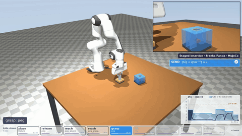](assets/videos/sim/franka_fmb.mp4) Staged insertion, 16 Eddies | [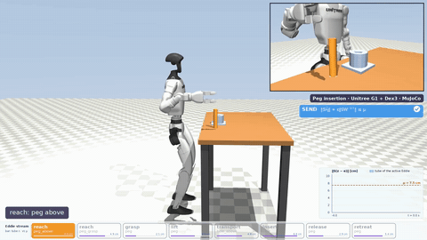](assets/videos/sim/g1_peg_insertion_sb.mp4) Peg insertion | [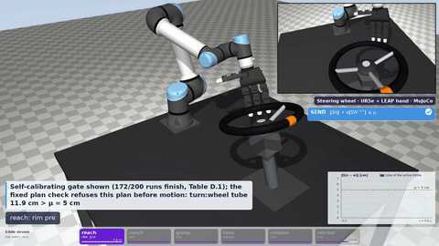](assets/videos/sim/leap_wheel_sb.mp4) Wheel (LEAP) | [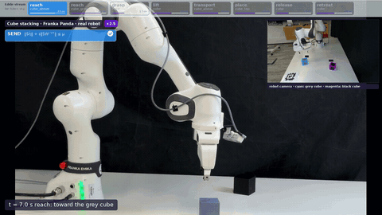](assets/videos/real/stacking.mp4) Cube stacking, 8 Eddies, both gates online |
| [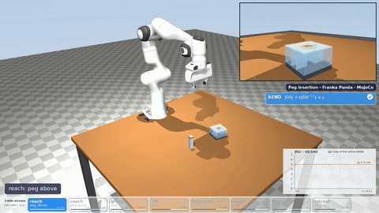](assets/videos/sim/franka_peg_insertion.mp4) Peg insertion | [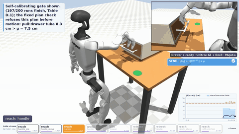](assets/videos/sim/g1_drawer_sb.mp4) Drawer + caddy | [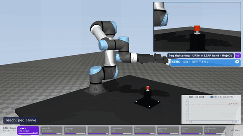](assets/videos/sim/leap_peg_tighten_sb.mp4) Peg tightening (LEAP) | [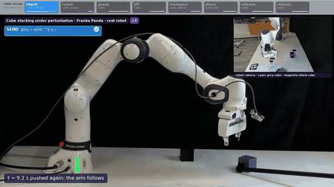](assets/videos/real/perturbation.mp4) Cube pushed out of the safe set: certified stop, then stacked |
| [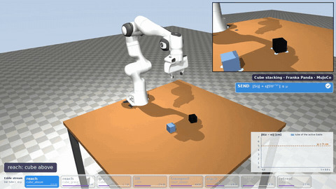](assets/videos/sim/franka_cube_stack.mp4) Cube stacking |  | [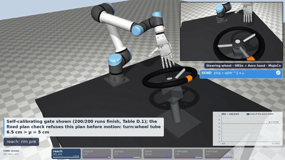](assets/videos/sim/aero_wheel_sb.mp4) Wheel (Aero) | [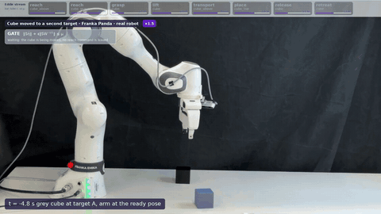](assets/videos/real/two_targets.mp4) Cube moved to a second target before the run: no command while it moves, then the whole stream |
| [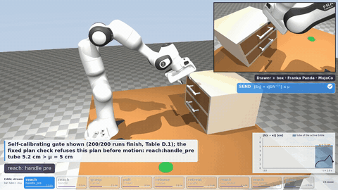](assets/videos/sim/franka_drawer.mp4) Drawer + box |  | [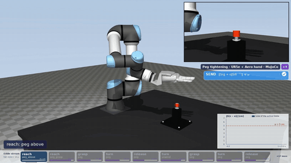](assets/videos/sim/aero_peg_tighten_sb.mp4) Peg tightening (Aero) | [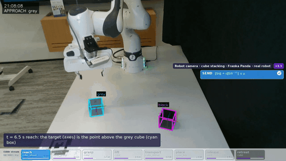](assets/videos/real/rgb_feed.mp4) Robot camera: the cube detections and targets the gate sees |

On the task clips the badge shows the self-calibrating gate's next-command check; the 2× clip
([`sim/franka_cube_stack_rho2.mp4`](assets/videos/sim/franka_cube_stack_rho2.mp4)) shows the fixed-calibration plan check
refusing the plan before motion. [`assets/videos/README.md`](assets/videos/README.md) documents every clip and overlay.

## Quick start

```bash
git clone https://github.com/Ozzey/EDDIES && cd EDDIES
pip install -e ".[test]"                     # numpy, scipy, pyyaml, matplotlib, mujoco, ...
scripts/download_menagerie.sh                # the five robots, pinned commit (~130 MB, simulation only)

python -m eddies.evaluate table1 table3 fig5 # reproduce tables and figures from results/ (no episodes needed)
python -m eddies.evaluate all                # every table (markdown) and figure -> assets/results/generated/

python -m eddies.envs.scripts.try_task --task franka_cube_stack --seeds 0 --methods bistl --workers 1   # one episode
MUJOCO_GL=egl python -m eddies.render --task franka_cube_stack --seed 2000 --out /tmp/eddies_render     # with video

datasets/download.sh --subset franka         # episode logs from Hugging Face (all subsets: ~2.4 GB)
python -m eddies.certify --robot franka      # identify + calibrate + test the Franka certificates from the logs
python -m eddies.gate self --task franka_cube_stack --known --mu 5   # replay the self-calibrating gate
scripts/reproduce.sh --list                  # recompute any result file from the episodes (docs/REPRODUCTION.md)
pytest -q                                    # unit tests + table reproduction
```

[docs/INSTALLATION.md](docs/INSTALLATION.md) · [docs/USAGE.md](docs/USAGE.md) · [docs/REPRODUCTION.md](docs/REPRODUCTION.md)

## Repository scope

| | |
| --- | --- |
| `eddies/core` | the maths: certificates, contracts and the product game, LTL_f, the command projection |
| `eddies/cert` | Eddies: identification, tubes, conformal calibration, both gates, chaining, the two Table 1 ablations, the learned proposer, tables and plots |
| `eddies/envs` | the ten MuJoCo tasks of the paper, the four robots' primitive vocabularies, controllers and the Streamer |
| `eddies/isaac` | optional Isaac Sim (PhysX) port used for Table 2 and Table 3 |
| `eddies/config.yaml`, `eddies/configs/` | every constant of the paper as YAML (robots, tasks, experiments) |
| `results/` | the result JSON behind every table and figure; episode logs and per-step gate margins live in the [dataset](https://huggingface.co/datasets/Ozzey/eddies) |
| `scripts/reproduce.sh` | one command per paper experiment, from the dataset to `results/` (`--list`; [docs/REPRODUCTION.md](docs/REPRODUCTION.md)) |
| `docs/` | [architecture](docs/ARCHITECTURE.md), [configs](docs/CONFIGS.md), [data format](docs/DATA_FORMAT.md), [tasks](docs/TASKS.md), [real robot](docs/REAL_ROBOT.md), [paper results](docs/PAPER_RESULTS.md), [FAQ](docs/FAQ.md) |

The real-robot driver (CRISP controller, RealSense perception) and the robot episode logs are not part of this
release ([docs/REAL_ROBOT.md](docs/REAL_ROBOT.md)).
Not recomputed by this release: the other token rows of Table 1 (one global model, one model per primitive, BeT,
FAST + k-means, VQ-BeT) with their App. D results, the reference-model one-step error and the second Franka split
of App. D, and the robot rows of Table 3 and Sec. 5.5 (printed from `results/real/table3_robot_rows.json`; the
robot logs are not released).

## Citation

```bibtex
@inproceedings{narendra2027eddies,
  title     = {Eddies: Dynamical Action Tokens with Certified Composition},
  author    = {Narendra, Aditya and Tadevosyan, Grik and Swikir, Abdalla},
  booktitle = {Learning for Dynamics and Control (L4DC)},
  year      = {2027}
}
```

## License

MIT, see [LICENSE](LICENSE). The episode dataset is CC-BY-4.0. Robot models come from
[MuJoCo Menagerie](https://github.com/google-deepmind/mujoco_menagerie) under their own licenses.
